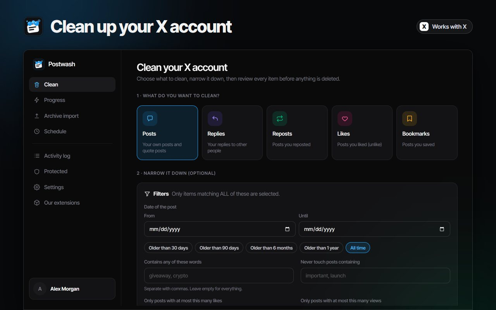
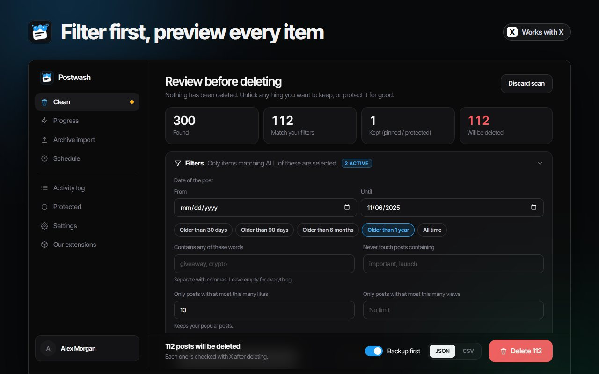
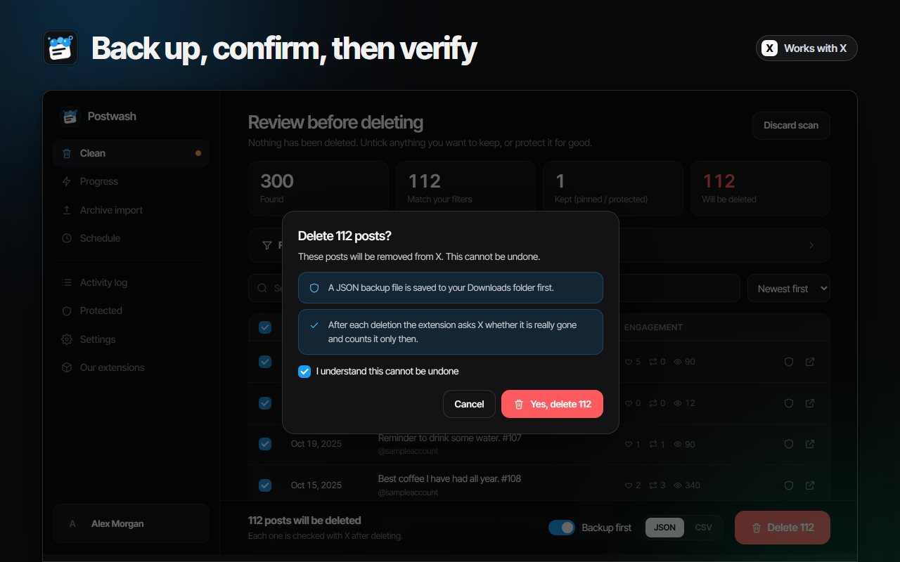
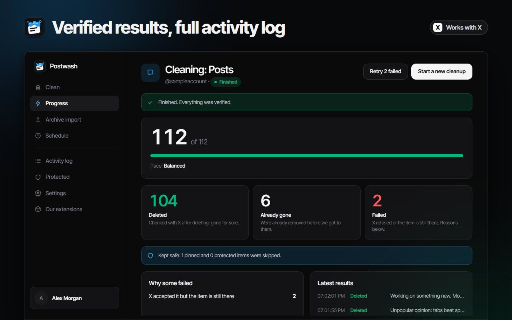

# Postwash: Delete All Tweets, Likes and Reposts on X (Twitter)

Postwash is a bulk tweet deleter for X (Twitter) that runs in your own Chrome browser. It shows you everything it found, saves a backup, deletes only what you approve, and checks every single deletion with X, without ever asking for your X password.

[Chrome Web Store](https://chromewebstore.google.com/detail/ekpgkebodiolpkdmddnjblnlldckhmfb?utm_source=github&utm_medium=readme&utm_campaign=postwash) | [Full guide and FAQ](https://www.addonschrome.com/extensions/postwash-delete-tweets-likes-reposts-for-x.html?utm_source=github&utm_medium=readme&utm_campaign=postwash) | [Video demo](https://www.youtube.com/watch?v=FwjjBMA-uTg)

This repository is the public home for Postwash documentation, release notes and the issue tracker. The extension itself is distributed through the Chrome Web Store.

## What it cleans

- Posts
- Replies
- Reposts
- Likes
- Bookmarks

## Features

- **Filters:** by date (older than 30 days, 90 days, 6 months, 1 year, or your own range), by words, by likes or views, and by media. Your pinned post stays untouched.
- **Preview first:** the whole list appears with date, text and engagement. Untick or protect anything you want to keep.
- **Backup first:** a CSV or JSON file with the text and details of everything about to go is saved to your Downloads folder before the first deletion. If it cannot be saved, nothing is deleted.
- **Every deletion verified:** X can report success when something went wrong. Postwash asks X again after each deletion and counts it only when the post is really gone. The activity log can be exported as CSV.
- **Past 3,000 posts:** import your X data archive (tweets.js and like.js) and delete by ID. The files are read on your computer and never uploaded.
- **Schedules:** daily or weekly cleanups, for example posts older than 30 days every week. Every scheduled run saves a backup first.
- **Pacing:** gentle, balanced or fast, with random pauses. Postwash follows X's rate-limit counter, slows down before it runs out and stops by itself if X pushes back.
- **50+ languages.**

## How to use

1. Log in to x.com, click the Postwash icon in Chrome and sign in with your Google account.
2. Pick posts, replies, reposts, likes or bookmarks, add filters, and press Scan. Nothing is deleted at this stage.
3. Review the list, untick or protect anything you want to keep.
4. Confirm. The backup is saved, then each deletion is checked with X. At the end you see deleted, already gone and failed counts.

## Pricing

Postwash is free to install from the Chrome Web Store.

## Privacy

Postwash works through the X session already open in your browser. It never asks for your X password, and your posts are read on your device and never sent to a server.

## Screenshots

## Support

Found a bug or have a feature request? [Open an issue](../../issues).

## Disclaimer

Postwash is an independent tool and is not affiliated with, endorsed by or sponsored by X Corp. X and Twitter are trademarks of their respective owner.

Built and maintained by [Addons Chrome](https://www.addonschrome.com/?utm_source=github&utm_medium=readme&utm_campaign=postwash).
